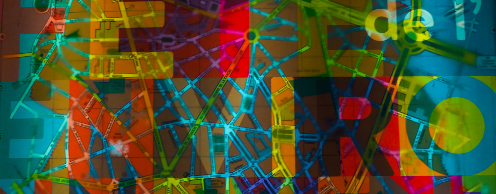

# -*- mode: org;  coding: utf-8; -*-
#+title:Etherpad & collaborative editing

[[https://melpa.org/#/etherpad][file:https://melpa.org/packages/etherpad-badge.svg]]

“Etherpad is a highly customizable Open Source online editor providing collaborative editing in really real-time. Etherpad allows you to edit documents collaboratively in real-time, much like a live multi-player editor that runs in your browser. Write articles, press releases, to-do lists, etc. together with your friends, fellow students or colleagues, all working on the same document at the same time.” https://etherpad.org/

* Real-time collaborative editing

Real-time editing relies on a websocket interface to an etherpad server forcollaborative editing using either browser or emacs.

To open a pad for editing  =M-x etherpad-connect= and enter the url of the pad.

* Install & configure

The etherpad emacs interface can be installed from [[https://melpa.org/#/etherpad][MELPA]] or manually via [[https://codeberg.org/zzkt/ethermacs][codeberg]].

#+BEGIN_SRC emacs-lisp
(use-package etherpad
  :config (setq etherpad-default-server "https://pad-dev.etherpad.org/"
                etherpad-author-name "Tashmetum"
                etherpad-author-colors t
                etherpad-debug nil))
#+END_SRC

See also =M-x customize-group RET etherpad=

Re: [[https://github.com/ether/etherpad/pull/7773][ether/etherpad#7773]]

#+BEGIN_SRC emacs-lisp
(setq etherpad-fixed-commit-window t
      etherpad-commit-window-time 1800)
#+END_SRC

** Key bindings

 - =C-c C-c=  etherpad-connect
 - =C-c C-l=  etherpad-disconnect
 - =C-c C-u=  etherpad-list-users
 - =C-c C-w=  etherpad-who-here
 - =C-c C-f=  etherpad-toggle-author-colors
 - =C-c C-e=  etherpad-export

* Further
 - [[https://etherpad.org/doc/v1.8.4/#index_api_methods][Etherpad HTTP API reference]]
 - [[https://raw.githubusercontent.com/ether/etherpad-lite/master/doc/easysync/easysync-full-description.pdf][Etherpad and EasySync Technical Manual]] (pdf)
 - [[https://lists.gnu.org/archive/html/emacs-devel/2020-10/msg00238.html][Re: Question collaborative editing]] (CRDT based collaborative editing in emacs)
