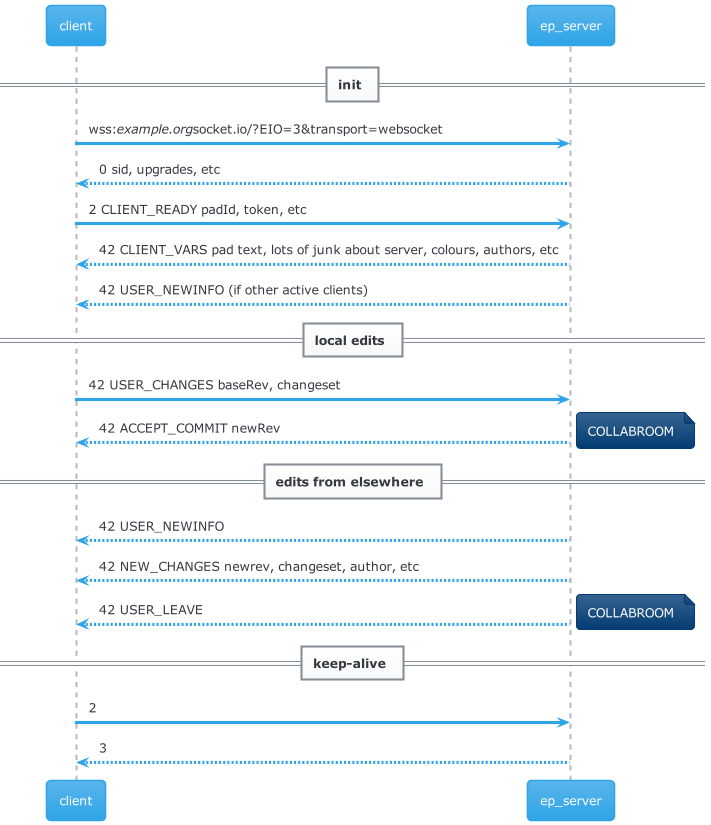
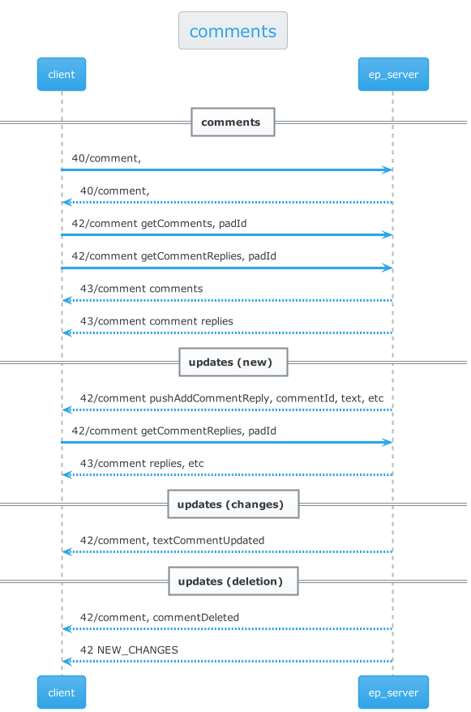

# -*- mode: org;  coding: utf-8; -*-
#+LaTeX_CLASS: zzkt-article
#+LateX_Header: \setcounter{secnumdepth}{0}
#+OPTIONS: toc:2
#+author:  nik gaffney
#+title: etherpad protocol notes

#+begin_export latex
\newpage
#+end_export
* etherpad & the easysync protocol

 - [[https://github.com/ether/etherpad-lite/tree/develop/doc/easysync][easysync protocol description & notes]]
 - [[http://geekdirt.com/blog/how-etherpad-works/][How etherpad-lite, a real time collaborative editor, works?]]

 possibly relevant parts of the etherpad code
  - https://github.com/ether/etherpad-lite/blob/develop/src/node/handler/PadMessageHandler.js
  - https://github.com/payload/ethersync/blob/master/src/ethersync.coffee
  - code for a [[https://github.com/JohnMcLear/etherpad-cli-client/blob/master/lib/index.js][cli-client]] and the [[https://github.com/ether/etherpad-lite/tree/develop/src/static/js][javascript client]]

* websockets & socket.io

etherpad uses socket.io for realtime communication between server and clients. socket.io uses ws and wss as transport protocols, but not directly compatible. appears to work as expected by adding headers and/or prefixes to json data sent via wss (“Socket.IO is NOT a WebSocket implementation” according to the [[https://socket.io/docs/][socket.io docs]])

* websockets in emacs

see  https://blog.abrochard.com/websockets.html and [[https://github.com/ahyatt/emacs-websocket][emacs-websocket]] for details

* protocol, probes & partials

browser client sends url with pad name to server (e.g.  https://etherpad.wikimedia.org/p/test ) establishes session (sid) and receives token (in cookie data). updates, changes & pad metadata are sent via wss connection.

e.g. =wss://etherpad.wikimedia.org/socket.io/?EIO=3&transport=websocket&sid=Ap47gBZD98dHcW38AoqY=

** flow
- Open WebSocket to =/socket.io/?EIO=4&transport=websocket=
- Engine.IO OPEN → send =40= (socket.io CONNECT)
- Socket.IO CONNECT ack → send CLIENT_READY
- Server responds with CLIENT_VARS (pad text, rev, apool)
- Normal editing loop: USER_CHANGES → ACCEPT_COMMIT / NEW_CHANGES

** overview

#+BEGIN_SRC plantuml :exports none :file proto-x1.png
!include https://raw.githubusercontent.com/bschwarz/puml-themes/master/themes/cerulean/puml-theme-cerulean.puml

== init ==
client -> ep_server: wss://example.org//socket.io/?EIO=3&transport=websocket
ep_server --> client: 0 sid, upgrades, etc
client -> ep_server: 2 CLIENT_READY padId, token, etc
ep_server --> client: 42 CLIENT_VARS pad text, lots of detail about server, colours, authors, etc
ep_server --> client: 42 USER_NEWINFO (if other active clients)

== local edits ==
client -> ep_server: 42 USER_CHANGES baseRev, changeset
ep_server --> client: 42 ACCEPT_COMMIT newRev
note right: COLLABROOM

== edits from elsewhere ==
ep_server --> client: 42 USER_NEWINFO
ep_server --> client: 42 NEW_CHANGES newrev, changeset, author, etc
ep_server --> client: 42 USER_LEAVE
note right: COLLABROOM

== keep-alive ==
client -> ep_server: 2
ep_server --> client: 3
#+END_SRC

#+CAPTION: overview of etherpad/easysync protocol
#+ATTR_ORG: :width 400
#+ATTR_LaTeX: :height 15cm :placement [H]

** comment plugin

#+BEGIN_SRC plantuml :exports none :file proto-x2.png
!include https://raw.githubusercontent.com/bschwarz/puml-themes/master/themes/cerulean/puml-theme-cerulean.puml

title comments

== comments ==
  client -> ep_server: 40/comment,
  ep_server --> client: 40/comment,
  client -> ep_server: 42/comment getComments, padId
  client -> ep_server: 42/comment getCommentReplies, padId
  ep_server --> client: 43/comment comments
  ep_server --> client: 43/comment comment replies

== updates (new) ==
  ep_server --> client: 42/comment pushAddCommentReply, commentId, text, etc
  client -> ep_server: 42/comment getCommentReplies, padId
  ep_server --> client: 43/comment replies, etc

== updates (changes) ==
  ep_server --> client: 42/comment, textCommentUpdated

== updates (deletion) ==
  ep_server --> client: 42/comment, commentDeleted
  ep_server --> client: 42 NEW_CHANGES

 #+END_SRC

#+CAPTION: comments
#+ATTR_ORG: :width 400
#+ATTR_LaTeX: :height 15cm :placement [H]

** example messages

*init/request*
#+BEGIN_SRC
40/comment,

42/comment,0["getComments",{"padId":"test"}]
42/comment,1["getCommentReplies",{"padId":"test"}]

43/comment,0[{"comments":{"c-4U2BW8J2Lp0r68ZL":{"author":"a.0iRJZx7jiOAxVNMP","name":"zzkt","text":"yes","timestamp":1607769834917}}}]

43/comment,1[{"replies":{}}]
#+END_SRC

*updates (new)*
#+BEGIN_SRC
42/comment,["pushAddCommentReply","c-reply-vMSgWSY4bFhaCCLR",{"commentId":"c-4U2BW8J2Lp0r68ZL","text":"no","changeTo":null,"changeFrom":null,"author":"a.0iRJZx7jiOAxVNMP","name":"zzkt","timestamp":1607770300230,"replyId":"c-reply-vMSgWSY4bFhaCCLR"}]

42/comment,2["getCommentReplies",{"padId":"test"}]

43/comment,2[{"replies":{"c-reply-vMSgWSY4bFhaCCLR":{"commentId":"c-4U2BW8J2Lp0r68ZL","text":"no","changeTo":null,"changeFrom":null,"author":"a.0iRJZx7jiOAxVNMP","name":"zzkt","timestamp":1607770300230}}}]
#+END_SRC

*updates (changes)*
#+BEGIN_SRC
42/comment,["textCommentUpdated","c-reply-vMSgWSY4bFhaCCLR","not yet"]
#+END_SRC

*updates (deletion)*
#+BEGIN_SRC
42/comment,["commentDeleted","c-4U2BW8J2Lp0r68ZL"]

42["message",{"type":"COLLABROOM","data":{"type":"NEW_CHANGES","newRev":234,"changeset":"Z:e>0=7*0=4$","apool":{"numToAttrib":{"0":["comment","comment-deleted"]},"attribToNum":{"comment,comment-deleted":0},"nextNum":1},"author":"a.0iRJZx7jiOAxVNMP","currentTime":1607770511397,"timeDelta":null}}]
#+END_SRC

** changesets

see: file:changeset-format.org

** attributes, colours, authors, etc

the “apool”
#+BEGIN_SRC
"apool":{"numToAttrib":{"0":["author","a.touCZaixjPgKDSiN"]},"nextNum":1}
#+END_SRC

author ids, names & colour mapping

** CLIENT_VARS

#+BEGIN_SRC
42["message",{"type":"CLIENT_VARS","data":{… [etc]
#+END_SRC

most directly useful
 - pad name - =[1]["data"]["padId"]=  (and also  =[1]["data"]["collab_client_vars"]["padId"]=)
 - revision - =[1]["data"]["collab_client_vars"]["rev"]=
 - pad text - =[1]["data"]["collab_client_vars"]["initialAttributedText"]["text"]=
 - text attributes (as changset )- =[1]["data"]["collab_client_vars"]["initialAttributedText"]["attribs"]=

authors
 - author list - =[1]["data"]["collab_client_vars"]["historicalAuthorData"]=
 - e.g.  ="a.ltSpoKLpHyziPkDn": {"name": "someone", "colorId": 46)}=

colo[u]rs
- array of hex values - =[1]["data"]["colorPalette"]=
- map authors -> colour -  e.g. =[1]["data"]["collab_client_vars"]["historicalAuthorData"]["a.TcyaduN34UmzJIxa"]["colorId"]=

plugins available
 - listed in  =[1]["data"]["plugins"]=
 - e.g. =[1]["data"]["plugins"]["plugins"]["ep_comments_page"]=
     - =["data"]["plugins"]["plugins"]["ep_etherpad-lite"]["package"]["description"]=
     - =["data"]["plugins"]["plugins"]["ep_etherpad-lite"]["package"]["version"]=

example/reduced

#+BEGIN_SRC
[
  "message",
  {
    "type": "CLIENT_VARS",
    "data": {
      "skinName": "colibris",
      "skinVariants": "super-dark-toolbar super-dark-background dark-editor",
      "randomVersionString": "0ec6de15",
      "accountPrivs": {
        "maxRevisions": 100
      },
      "automaticReconnectionTimeout": 5,
      "initialRevisionList": [],
      "initialOptions": {
        "guestPolicy": "deny"
      },
      "savedRevisions": [],
      "collab_client_vars": {
        "initialAttributedText": {
          "text": "ethereal\n",
          "attribs": "*0+8|1+1"
        },
        "clientIp": "127.0.0.1",
        "padId": "test2",
        "historicalAuthorData": {
          "a.ltSpoKLpHyziPkDn": {
            "name": null,
            "colorId": 46
          },
          "a.touCZaixjPgKDSiN": {
            "name": null,
            "colorId": 7
          },
          "a.TcyaduN34UmzJIxa": {
            "name": null,
            "colorId": 31
          }
        },
        "apool": {
          "numToAttrib": {
            "0": [
              "author",
              "a.touCZaixjPgKDSiN"
            ]
          },
          "nextNum": 1
        },
        "rev": 174,
        "time": 1607568522484
      },
      "colorPalette": [
        "#ffc7c7",
        "#fff1c7",
        "#e3ffc7",
        "#c7ffd5",
        "#c7ffff",
        "#c7d5ff",
        "#e3c7ff",
        "#ffc7f1",
        "#ffa8a8",
        "#ffe699",
        "#cfff9e",
        "#99ffb3",
        "#a3ffff",
        "#99b3ff",
        "#cc99ff",
        "#ff99e5",
        "#e7b1b1",
        "#e9dcAf",
        "#cde9af",
        "#bfedcc",
        "#b1e7e7",
        "#c3cdee",
        "#d2b8ea",
        "#eec3e6",
        "#e9cece",
        "#e7e0ca",
        "#d3e5c7",
        "#bce1c5",
        "#c1e2e2",
        "#c1c9e2",
        "#cfc1e2",
        "#e0bdd9",
        "#baded3",
        "#a0f8eb",
        "#b1e7e0",
        "#c3c8e4",
        "#cec5e2",
        "#b1d5e7",
        "#cda8f0",
        "#f0f0a8",
        "#f2f2a6",
        "#f5a8eb",
        "#c5f9a9",
        "#ececbb",
        "#e7c4bc",
        "#daf0b2",
        "#b0a0fd",
        "#bce2e7",
        "#cce2bb",
        "#ec9afe",
        "#edabbd",
        "#aeaeea",
        "#c4e7b1",
        "#d722bb",
        "#f3a5e7",
        "#ffa8a8",
        "#d8c0c5",
        "#eaaedd",
        "#adc6eb",
        "#bedad1",
        "#dee9af",
        "#e9afc2",
        "#f8d2a0",
        "#b3b3e6"
      ],
      "clientIp": "127.0.0.1",
      "userIsGuest": true,
      "userColor": 7,
      "padId": "test2",
      "padOptions": {
        "noColors": false,
        "showControls": true,
        "showChat": false,
        "showLineNumbers": false,
        "useMonospaceFont": false,
        "userName": true,
        "userColor": true,
        "alwaysShowChat": false,
        "chatAndUsers": false,
        "ShowComments": true,
        "lang": "en-gb",
        "rtl": false
      },
      "padShortcutEnabled": {
        "altF9": true,
        "altC": true,
        "cmdShift2": true,
        "delete": true,
        "return": true,
        "esc": true,
        "cmdS": true,
        "tab": true,
        "cmdZ": true,
        "cmdY": true,
        "cmdI": true,
        "cmdB": true,
        "cmdU": true,
        "cmd5": true,
        "cmdShiftL": true,
        "cmdShiftN": true,
        "cmdShift1": true,
        "cmdShiftC": true,
        "cmdH": true,
        "ctrlHome": true,
        "pageUp": true,
        "pageDown": true
      },
      "initialTitle": "Pad: test2"
    }
  }
]

#+END_SRC

#+begin_export latex
\newpage
#+end_export
* various tools & accessories

 - Firefox/Chrome/Safari → network/ws/messages/console/log etc
 - =git clone https://github.com/guyzmo/PyEtherpadLite=
 - wscat
 - netcat

* testing & tracing

#+BEGIN_SRC emacs-lisp
(defun ethertest-loop ()
  (interactive)
  (with-current-buffer *etherpad-buffer*
    (let ((server-url "wss://example.org/socket.io/?EIO=3&transport=websocket")
          (pad "test"))
      (text-mode)
      (etherpad-mode)
      (ethersync-current-socket
       (websocket-open subtest
                            :on-message #'ethersync-parse-wsframe
                            :on-error (lambda (_websocket type err)
                                        (message "ws error: %s %s" type err))
                            :on-close (lambda (_websocket)
                                        (message "websocket closed"))))
      (let* ((*subtest-socket* (ethersync-current-socket)))
        (message "protocols: %s" (websocket-negotiated-protocols  *subtest-socket*))
        (message "extensions: %s" (websocket-negotiated-extensions  *subtest-socket*))
        (message "cookies? %s" url-cookie-storage)
        ;; init & keep alive
        (ethersync-heartbeat-start)
        (sleep-for 1)
        ;; request data
        (wss-send (ethersync--request-client-ready pad))
        ;; etcn
        ))))
#+END_SRC

#+BEGIN_SRC
  ❯ wscat  -c "wss://example.org/socket.io/?EIO=3&transport=websocket"
  Connected (press CTRL+C to quit)
  < 0{"sid":"6_TVij3sJug26KFLAAGc","upgrades":[],"pingInterval":25000,"pingTimeout":5000}
  < 40
  >
#+END_SRC

#+BEGIN_SRC
[
  "message",
  {
    "type": "COLLABROOM",
    "data": {
      "type": "NEW_CHANGES",
      "newRev": 969,
      "changeset": "Z:2r>2*0=1=5*1|1+1*1*2*3*4*5+1|1=1*6=1|1=4*7=1|1=4*8=1|1=a*9=1|1=5*0=1|1=f*0=1|1=q*5=1|1=4*6=1|1=4*7=1|1=4*8=1$\n*",
      "apool": {
        "numToAttrib": {
          "0": [
            "start",
            "1"
          ],
          "1": [
            "author",
            "a.TA0tvO487Oh304Up"
          ],
          "2": [
            "insertorder",
            "first"
          ],
          "3": [
            "list",
            "number1"
          ],
          "4": [
            "lmkr",
            "1"
          ],
          "5": [
            "start",
            "2"
          ],
          "6": [
            "start",
            "3"
          ],
          "7": [
            "start",
            "4"
          ],
          "8": [
            "start",
            "5"
          ],
          "9": [
            "start",
            "6"
          ]
        },
        "attribToNum": {
          "start,1": 0,
          "author,a.TA0tvO487Oh304Up": 1,
          "insertorder,first": 2,
          "list,number1": 3,
          "lmkr,1": 4,
          "start,2": 5,
          "start,3": 6,
          "start,4": 7,
          "start,5": 8,
          "start,6": 9
        },
        "nextNum": 10
      },
      "author": "a.TA0tvO487Oh304Up",
      "currentTime": 1638017098574,
      "timeDelta": 8923
    }
  }
]
#+END_SRC
